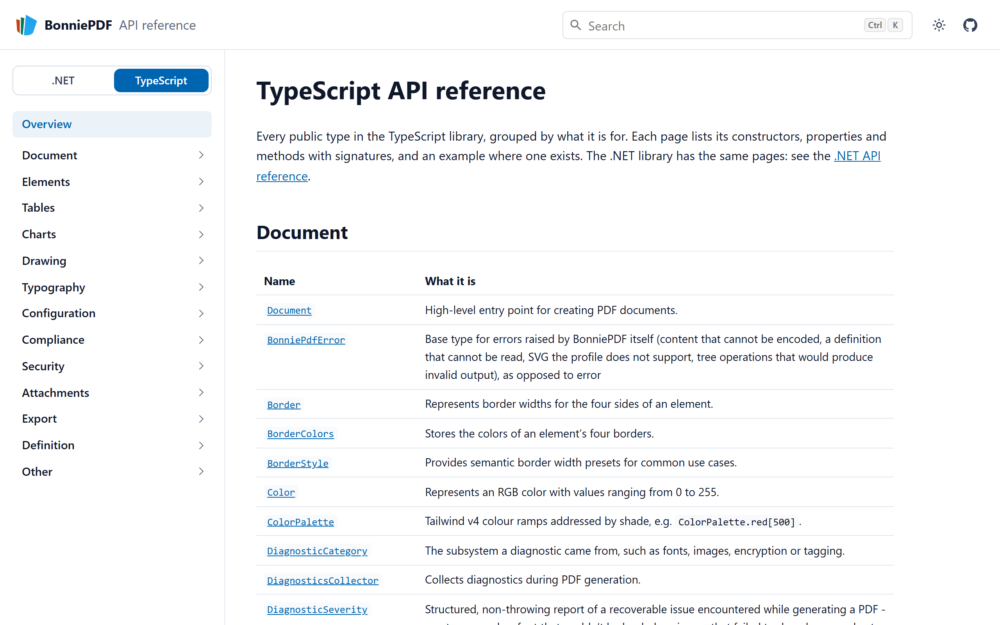

# BonniePDF API documentation

The API reference for [BonniePDF](https://www.bonniepdf.dev): every public type in the TypeScript and .NET libraries, with constructors, properties, methods, signatures and the examples written in the doc comments.



| Library    | Package           | Reference                           |
| ---------- | ----------------- | ----------------------------------- |
| TypeScript | `@bonniepdf/core` | [typescript/](typescript/README.md) |
| .NET       | `BonniePDF`       | [dotnet/](dotnet/README.md)         |

Both languages have the same page for the same type, so a page in one folder has a twin with the same file name in the other where the type exists in both.

## Where the pages come from

Every page is generated from the doc comments in the libraries (TSDoc in `BonniePDF-TypeScript`, XML documentation in `BonniePDF-NET`), so **do not edit the pages here**: a change made in this repository is overwritten the next time the reference is generated. To correct or improve an entry, change the doc comment in the library and it will appear here with the next generation.

For guides, tutorials and examples that show how to use the libraries, see [www.bonniepdf.dev](https://www.bonniepdf.dev).

## Browsing the reference locally

The repository includes a small [Astro](https://astro.build) site that serves these pages with a sidebar and full-text search. It needs Node 22 or later and pnpm.

```bash
pnpm install
pnpm build     # builds the site into dist/ and the search index into dist/pagefind/
pnpm dev       # http://localhost:2001
```

Search is powered by [Pagefind](https://pagefind.app), which indexes the built site, so run `pnpm build` once before searching in `pnpm dev`. The site reads the Markdown in place and builds its sidebar from each folder's `README.md`; it does not change the pages.

## Licence

This reference documents BonniePDF and is distributed under the [BonniePDF Community License 1.0](LICENSE), the licence of the libraries it is generated from. Commercial terms are at [www.bonniepdf.dev/pricing](https://www.bonniepdf.dev/pricing).
